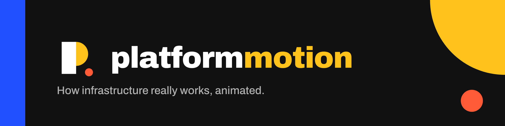

  

Animated diagrams that show what happens inside Kubernetes, service meshes, GitOps, Linux and the cloud. We explain the moving parts, not the install steps.

  &nbsp;
  &nbsp;
  &nbsp;
  &nbsp;
  &nbsp;
  &nbsp;
  

